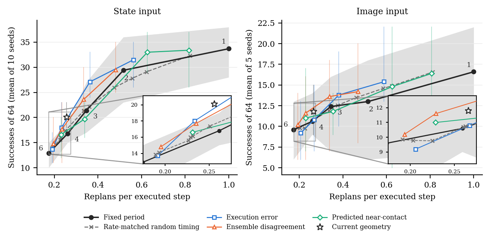

# When to Replan in Tabletop Pushing

Project period: July–November 2026.

This PushT simulation study compares fixed and signal-triggered replanning over 35-step episodes.

The [controller](run.py) rolls out candidate actions with a dynamics ensemble using either direct state input or RGB pose estimates. The [evaluation](stage23/rev_eval.py) counts model predictions and records success when the object exceeds 95% target coverage at any step.



## Reference results

| Comparison | Result |
| --- | --- |
| Every step versus every fourth step under nominal dynamics | 33.7 versus 16.8 successes per 64 tasks on average across ten state-input training seeds |
| Every step versus every fourth step at 2,304 prediction units per step | 33.7 versus 23.5 mean successes. The 95% interval for the difference is +2.6 to +17.5. |
| Signal-triggered replanning versus shuffled schedules | Across eight prespecified comparisons, none reached significance after Holm correction. |

The figures and tables summarize reference simulations on the same 64 held-out tasks. The shuffled control replays whole schedules on different tasks to isolate whether responding to the current state improves success.

[Matched-compute figure](figures/matched-compute.png) · [Shuffled-schedule figure](figures/shuffled-schedules.png) · [Stage 2 results](stage23/stage2.json) · [Stage 3 results](stage23/stage3.json)

Read the [Stage 2 analysis plan](stage23/analysis_plan.md) and the [Stage 3 analysis plan](stage23/analysis_plan_stage3.md) for the comparison groups, metrics and statistical procedures.

## Run the simulator study

Use Python 3.12 from the repository root.

```bash
python -m venv .venv
source .venv/bin/activate
python -m pip install -r requirements.txt
python run.py --help
python run_protocol.py --profile pilot --prefix local_ --workers 4
```

The last command prints and writes the pilot protocol. Add `--execute` to collect trajectories, fit the ensembles and run the pilot. Outputs use the `local_` prefix. The code generates data with the upstream [gym-pusht simulator](https://github.com/huggingface/gym-pusht). The repository carries aggregate reference results. Training checkpoints and per-episode archives are regenerated locally.

After the pilot, run the multi-seed scripts from `stage23/` using the same prefix and environment.

```bash
cd stage23
python rev_driver.py --prefix local_ --workers 4 --device auto
python rev_analysis.py --prefix local_
python rev_stage3.py --prefix local_ --workers 4
python rev_analysis3.py --prefix local_
python verify_stage23.py --prefix local_
```

The reference RGB models used Apple MPS. Device changes can change training and rollout results.

The optional [trigger-rate diagnostic](stage23/rev_s14.py) compares the 75th-percentile near-contact and execution-error rules on calibration and nominal test tasks; [s14.json](stage23/s14.json) records per-seed trigger rates (`cal`/`test`), calibration success (`cal_success`) and seed averages. After Stage 2, run `python rev_s14.py --prefix local_` from `stage23/`: it reads `local_results/state_s*/meta.json`, `episodes.csv` and the matching models, reruns calibration, and writes `local_s14.json`; trigger rates count signal-triggered replans per eligible step before first success or step 35, excluding initial and forced replans.
